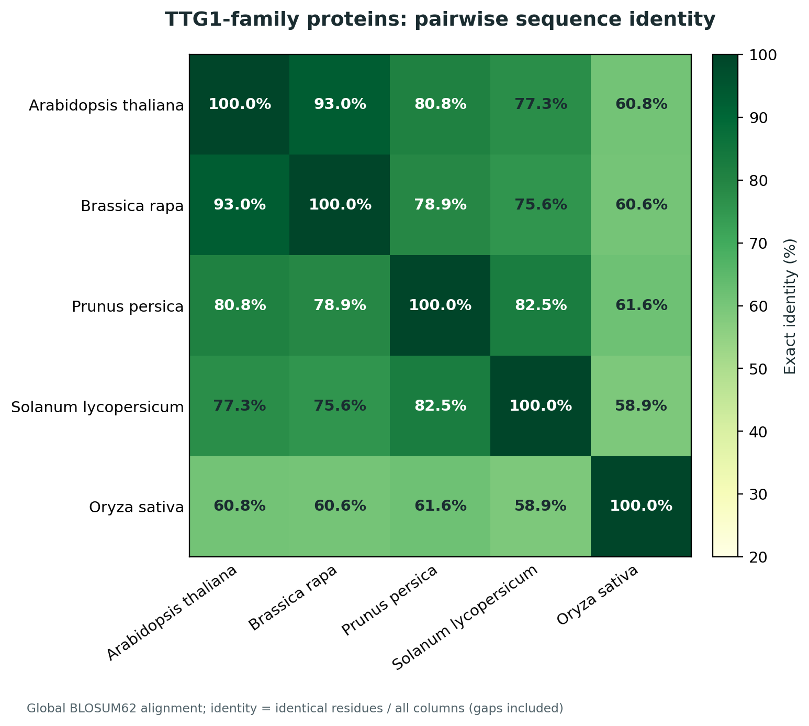
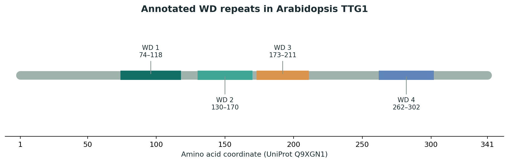

# TTG1 sequence analysis in Arabidopsis and other plants

Python · Biopython · Molecular genetics · Protein alignment

I first worked with the **TTG1 gene (AT5G24520)** during an Arabidopsis CRISPR-genotyping practical at Bielefeld University. That work involved DNA extraction, PCR, gel electrophoresis and NcoI digestion. This repository is a **separate computational follow-up** using public reference sequences, not a reanalysis of my laboratory samples.

## Question

Do the four annotated Arabidopsis TTG1 transcripts encode different proteins? How much of the TTG1 protein sequence is retained in selected plants from other families?

TTG1 is a WD-repeat protein involved in trichome development, root epidermal patterning and anthocyanin biosynthesis ([NCBI Gene 832523](https://www.ncbi.nlm.nih.gov/gene/832523)).

## Data and approach

- **Arabidopsis transcripts:** `NM_122360.2`, `NM_180738.3`, `NM_180739.2` and `NM_001343878.1` (NCBI RefSeq GenBank records, including annotated coding sequences).
- **Protein reference:** `Q9XGN1` (reviewed UniProt TTG1, with WD-repeat annotations).
- **Comparative proteins:** *Brassica rapa* (`ABQ10570`), *Prunus persica* (`ACQ65867`), *Solanum lycopersicum* (`XP_004235332`) and *Oryza sativa* (`BAF09665`). These accessions were reported in a [published TTG1-family comparison](https://pubmed.ncbi.nlm.nih.gov/36233274/).

The species sample includes a Brassicaceae relative, two other eudicots and a monocot. It illustrates different levels of conservation; it was **not** selected by an orthology-inference pipeline.

The Python scripts calculate transcript/CDS GC content, scan candidate ORFs, validate the annotated CDS translation, and compare full-length proteins. **Global** rather than local alignment is used because the comparison concerns the complete proteins, not just a shared short region. Biopython `PairwiseAligner` uses BLOSUM62 with gap-open −10 and gap-extension −0.5; these are fixed conventional settings, not optimized parameters. For the first version, identity is the number of identical amino-acid columns divided by **all alignment columns, including gaps**.

## Results

All four RefSeq mRNAs have different lengths (**1,436–1,831 nt**) but share the same annotated **1,026-nt CDS**. Their translated 341-aa sequences match UniProt Q9XGN1.

| Compared with Arabidopsis TTG1 | Global protein identity |
| --- | ---: |
| *Brassica rapa* | 92.96% |
| *Prunus persica* | 80.81% |
| *Solanum lycopersicum* | 77.33% |
| *Oryza sativa* | 60.77% |



The four WD repeats annotated in the Arabidopsis reference occupy residues **74–118, 130–170, 173–211 and 262–302**. They are imported from UniProt, not predicted de novo.



Additional plots: [mRNA sliding-window GC](results/figures/gc_profile.png) · [candidate ORFs](results/figures/orf_candidates.png). The corresponding CSV tables and alignments are in [`results/`](results/); the original source records and a SHA-256 manifest are in [`data/`](data/).

## Reproduce the analysis

Requires Python 3.11+.

```bash
python3 -m venv .venv
source .venv/bin/activate  # macOS/Linux
python -m pip install -r requirements.txt
python -m src.align_analysis
python -m src.visualize
python -m unittest discover -s tests -v
```

Raw inputs are included, so these steps run offline. To download the accession-checked records again, use `python -m src.fetch_seq --refresh`. Results are saved as CSV, JSON, PNG and SVG files.

## Limitations and next question

This is a small, literature-guided comparison of **homologous proteins**, not proof that every pair represents a one-to-one ortholog. Identity depends on alignment settings and denominator; it cannot by itself establish a species tree. The ORF scan is exploratory, whereas coding regions come from NCBI annotations. GC profiles are calculated on **mRNA**, not genomic DNA.

For a next step, I want to compare sequence identity **within each WD-repeat region** against the full protein. A separate, sample-aware extension could examine the NcoI restriction site in the genomic PCR amplicon used in the university practical; the experimental alleles are not part of this dataset.

## Sources

Primary data: [NCBI TTG1](https://www.ncbi.nlm.nih.gov/gene/832523), [NM_122360.2](https://www.ncbi.nlm.nih.gov/nuccore/NM_122360.2), [UniProt Q9XGN1](https://www.uniprot.org/uniprotkb/Q9XGN1/entry). Biological background: [Walker et al., *Plant Cell* (1999)](https://pubmed.ncbi.nlm.nih.gov/10402433/).
