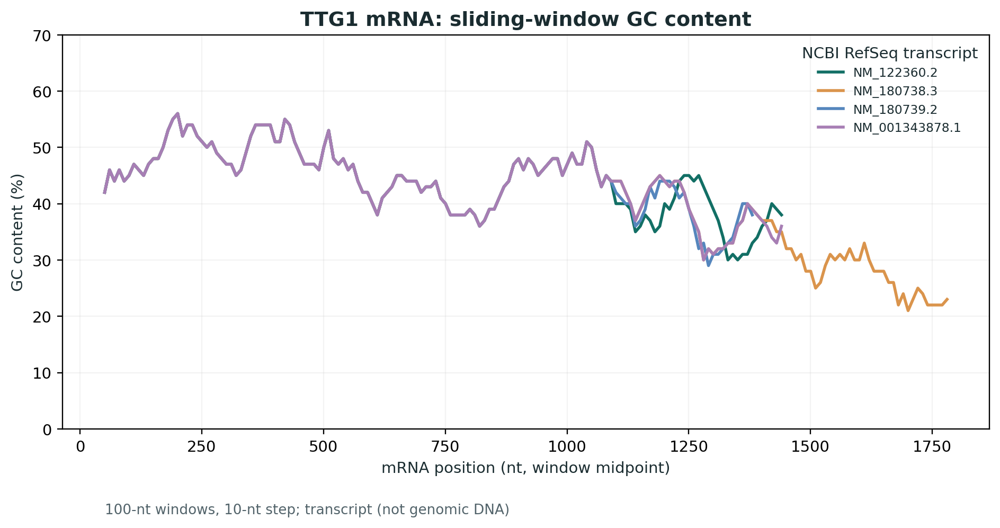
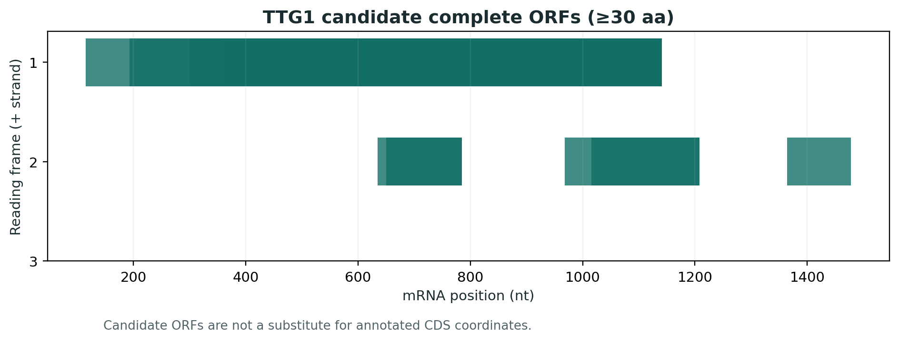

# Arabidopsis TTG1 | Gene & Comparative Sequence Analysis

**A reproducible Python/Biopython case study of TTG1 (`AT5G24520`) and selected plant TTG1-family proteins.**

`Python` · `Biopython` · `Molecular genetics` · `RefSeq/UniProt` · `Global sequence alignment` · `Sequence visualization`

## Scientific question

What sequence-level features characterize the Arabidopsis *TRANSPARENT TESTA GLABRA 1* (TTG1) gene, and how strongly is its encoded protein conserved across a small sample of plants?

TTG1 is a WD-repeat regulatory protein involved in trichome development, epidermal cell fate, root hair patterning and anthocyanin biosynthesis. It is associated with MYB–bHLH–WD40 (MBW) complexes. A relevant Arabidopsis gene locus is **AT5G24520** (NCBI Gene **832523**).

### Outputs

| Visualization | What it shows |
| --- | --- |
|  | Sliding-window GC across four annotated NCBI TTG1 **mRNA** records |
|  | Exact amino-acid identity after global pairwise alignment of five plant sequences |
|  | Source-annotated WD repeats in Arabidopsis TTG1 (UniProt Q9XGN1) |
|  | Candidate open reading frames in one transcript, separate from the NCBI-annotated CDS |

### Observations from the frozen input records

- The four TTG1 mRNAs range from **1,436 to 1,831 nt**. Their NCBI-annotated CDS is **1,026 nt** in each case and encodes the **same 341-aa protein**, matching UniProt Q9XGN1. This illustrates how differences in transcript length need not change the encoded amino-acid sequence.
- Using the documented global-alignment settings, *Arabidopsis* TTG1 shares **92.96%** exact identity with the chosen *Brassica rapa* protein, **80.81%** with *Prunus persica*, **77.33%** with *Solanum lycopersicum*, and **60.77%** with *Oryza sativa* (identity denominator includes all gap columns).
- UniProt Q9XGN1 marks four WD features at **74–118**, **130–170**, **173–211**, and **262–302** amino acids. These are database annotations, not novel motifs predicted by this study.

## Methods

1. **Data provenance:** Fetch four versioned TTG1 mRNAs from NCBI RefSeq in *GenBank* format (including CDS annotations), the reviewed Arabidopsis protein and repeat annotations from UniProt, and four published plant TTG1/WD40-related proteins from NCBI Protein. Save raw records and a SHA-256 source manifest.
2. **Transcript analysis:** Calculate mRNA GC%, annotated CDS GC%, CDS length and translated protein length; validate GenBank translation and compare translated sequence to the UniProt reference.
3. **Sliding window:** Calculate GC% in overlapping 100-nucleotide windows shifted by 10 nt each. Plot one curve per transcript.
4. **ORF candidates:** Scan all three forward-strand reading frames from every `ATG` to the first in-frame stop codon; report complete candidate ORFs at least 30 aa long. **The biologically annotated CDS comes from NCBI**, not from guessing which candidate ORF is correct.
5. **Protein comparisons:** Align the full protein sequences globally with Biopython `PairwiseAligner`, BLOSUM62, gap-opening penalty −10 and extension penalty −0.5. Report **percentage identity = exactly matching residues / all alignment columns (including gaps) × 100**.
6. **WD mapping:** Plot the four annotated `WD` features directly from the UniProt Q9XGN1 JSON record. Do not claim that the same coordinates automatically apply to other species.
7. **Plots:** Save PNG and editable SVG versions for reuse in the README or scientific presentations.

### Input sequences

| Species | Record | Type / authority | Reason for inclusion |
| --- | --- | --- | --- |
| *Arabidopsis thaliana* | `NM_122360.2`, `NM_180738.3`, `NM_180739.2`, `NM_001343878.1` | NCBI RefSeq mRNA | Four transcripts of TTG1; **not** four different genes |
| *Arabidopsis thaliana* | `Q9XGN1` | UniProtKB/Swiss-Prot | Reviewed TTG1 reference protein and WD-repeat coordinates |
| *Brassica rapa* | `ABQ10570` | NCBI Protein | Reported TTG1-related protein, Brassicaceae |
| *Prunus persica* | `ACQ65867` | NCBI Protein | Reported TTG1-related protein, Rosaceae |
| *Solanum lycopersicum* | `XP_004235332` | NCBI RefSeq Protein | Reported TTG1-related protein, Solanaceae |
| *Oryza sativa* | `BAF09665` | NCBI Protein | Reported TTG1-related protein, monocot |

These are **literature-supported homologous/TTG1-related proteins**, not an independently verified set of single-copy one-to-one orthologs. Pairwise identity is not proof of orthology.

## How to run on macOS, Linux or Windows

Python **3.11+** is recommended. Open a terminal in this repository folder.

```bash
python3 -m venv .venv
source .venv/bin/activate  # Windows PowerShell: .venv\Scripts\Activate.ps1
python -m pip install -r requirements.txt
python -m src.fetch_seq
python -m src.align_analysis
python -m src.visualize
python -m unittest discover -s tests -v
```

Only the fetch step needs internet access. The analysis and plotting steps work from the committed raw inputs. To intentionally refresh previously downloaded records, run `python -m src.fetch_seq --refresh` and review changes to the accessions and `data/source_manifest.csv`.

### File structure

```text
arabidopsis-ttg1-analysis/
├── README.md
├── GUIDE_FA.md                   # Explanations and GitHub steps in Persian
├── requirements.txt
├── src/
│   ├── fetch_seq.py             # Source downloads and provenance
│   ├── align_analysis.py        # GC, CDS, translation, ORF, protein identity
│   └── visualize.py             # PNG/SVG charts
├── data/
│   ├── raw/                     # Original GenBank, FASTA and UniProt JSON
│   └── source_manifest.csv      # URL, timestamp and SHA-256
├── results/
│   ├── transcript_summary.csv
│   ├── sliding_gc.csv
│   ├── orf_candidates.csv
│   ├── wd40_annotations.json
│   ├── homologs_used.fasta
│   ├── pairwise_identity_matrix.csv
│   ├── pairwise_alignments.txt
│   ├── summary.json
│   └── figures/                 # Four plots in PNG and SVG
├── notes/
│   └── wetlab_connection.md
└── tests/
    └── test_analysis.py
```

## Interpretation and limitations

- The mRNA includes UTRs and differs from genomic DNA, so the sliding GC plot is an **mRNA profile**, not a gene-region or promoter GC profile.
- Alternative transcripts are not biological replicates; their identities/lengths are documented, not treated as independent evolutionary samples.
- Short ORFs are computational candidates. NCBI's deposited CDS annotation is authoritative for the canonical coding region being studied.
- Identity depends on the alignment scoring settings and the stated gap-inclusive denominator. It is **not** the same as biochemical substitution-matrix similarity.
- Only a handful of published homologs are compared. Functional equivalence, strict orthology, and evolutionary branching **cannot be established from this small comparison alone**.
- This version deliberately does **not** build a phylogenetic tree. A later version can add curated orthogroup identification, a protein MSA (e.g. MAFFT or FAMSA), alignment-quality checks, and a supported exploratory gene tree with bootstrapping and an appropriate outgroup.
- The WD-repeat boundaries are UniProt feature annotations on the Arabidopsis reference only; no de novo motif prediction is claimed.
- The computational work here does not constitute a new wet-lab experiment. If linking to coursework, add actual original lab notebook/protocol evidence and distinguish observed experimental results from the bioinformatics extension.

## Sources

1. [NCBI Gene 832523: Arabidopsis TTG1 (AT5G24520)](https://www.ncbi.nlm.nih.gov/gene/832523)
2. [NCBI RefSeq mRNA NM_122360.2](https://www.ncbi.nlm.nih.gov/nuccore/NM_122360.2)
3. [UniProtKB/Swiss-Prot Q9XGN1: TTG1_ARATH](https://www.uniprot.org/uniprotkb/Q9XGN1/entry)
4. [Walker et al., 1999. *The TRANSPARENT TESTA GLABRA1 locus ... encodes a WD40 repeat protein*, Plant Cell](https://pubmed.ncbi.nlm.nih.gov/10402433/)
5. [RsTTG1 sequence comparison study (2022) listing the cross-species accessions](https://pubmed.ncbi.nlm.nih.gov/36233274/)

## Next steps

- Validate accession choices and putative one-to-one orthology in a curated resource before building evolutionary claims.
- Extend to a quality-checked multiple sequence alignment, annotate conserved columns and map WD-repeat conservation across the MSA.
- If authentic wet-lab notes are available, connect observed TTG1 PCR/restriction-digest results with a *separate* computational NcoI restriction-site analysis and clearly mark sample-specific alleles.

## Attribution

Sequence records and features belong to their original public databases and cited researchers. This repository is an educational, reproducible computational case study. Users should review the code, verify the biological interpretation, and document their own modifications and contributions before citing it as independent project work.

